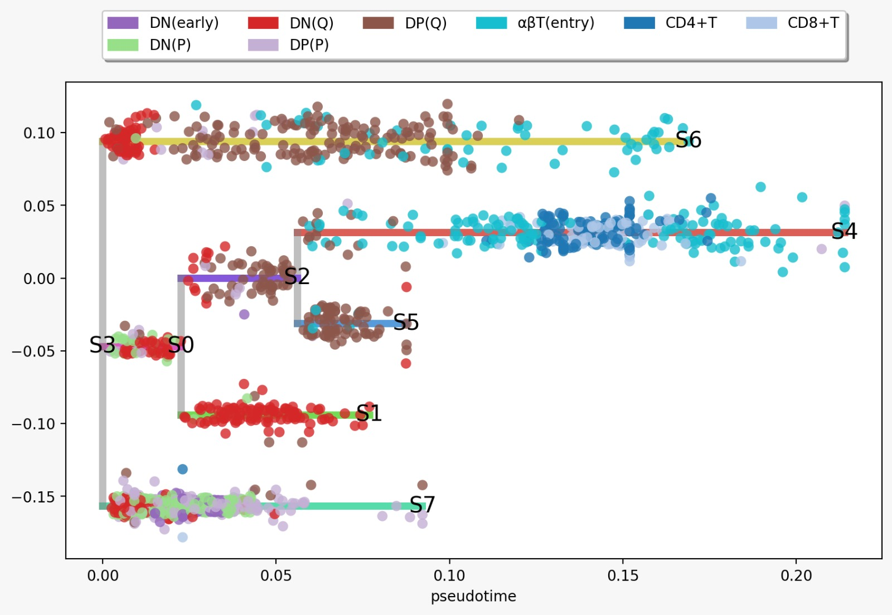
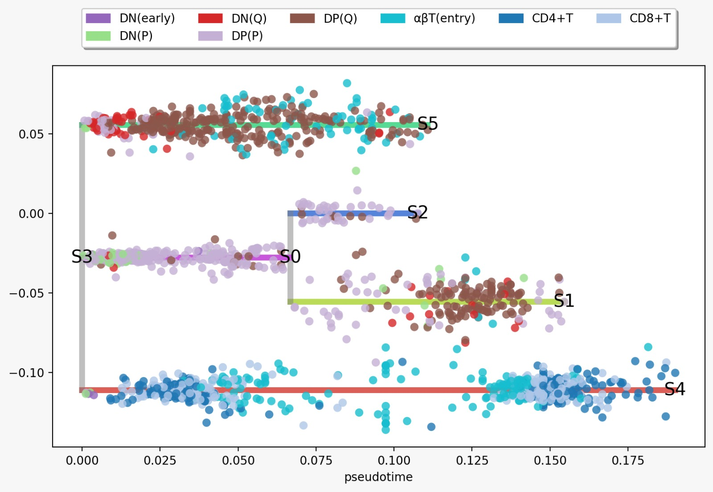

# Case Study 2: T-Cell Differentiation

## Overview

This case study applies the computational pipeline developed by Chevalier et al. (2025) to a new dataset describing human thymic development and T-cell differentiation, based on Park et al. (2020).

The data are available through the [Human Cell Atlas project](https://explore.data.humancellatlas.org/projects/c1810dbc-16d2-45c3-b45e-3e675f88d87b), with the corresponding dataset hosted on [Zenodo](https://zenodo.org/records/3572422).

We focus on the human T-cell dataset, specifically `thymus_annotated_matrix_files/HTA08.v01.A06.Science_human_tcells.h5ad`. The original study describes expected cellular differentiation trajectories based on biological evidence. These trajectories serve as a reference for evaluating and corroborating the trajectories inferred using STREAM.

Some input files for human genome annotation are too large for github access, and can be found here: 

Homo_sapiens.gene_info: https://www.ncbi.nlm.nih.gov/refseq/annotation_euk/Homo_sapiens/108/

msigdb.v2026.1.Hs.symbols.gmt: https://data.broadinstitute.org/gsea-msigdb/msigdb/release/2026.1.Hs/

## Repository Structure

```text
Case_Study_2_T_cells/
├── Data/
│   └── Input and processed T-cell dataset
├── Models/
│   └── Boolean network models generated using BoNesis
├── Code/
│   ├── 1_Data_prep.ipynb
│   ├── 2-STREAM_T_cells_12w_17w.ipynb
│   ├── 3-Binarization_STREAM_12w_17w.Rmd
│   ├── 4-Component_selection.ipynb
│   ├── 5-Component_analysis_12w_vs_17w.ipynb
│   ├── 6-Boolean_network_sampling.ipynb
│   └── 7-Ensemble_analysis_interactiongraph_Tcell_12w_17w.ipynb
├── Environment/
│   └── Conda environment files
└── Results/
    └── Outputs generated at each step of the analysis
```

## Analysis Workflow

The analysis consists of the following steps:

1. **Trajectory inference with STREAM** — reconstruct cellular differentiation trajectories and identify groups of cells with related expression profiles.
2. **Gene expression binarization with PROFILE** — classify gene expression into binary states or undetermined values and aggregate observations by STREAM-defined cell clusters.
3. **Component selection** — identify the genes and regulatory components used for Boolean network inference.
4. **Component analysis** — characterize the selected components and assess their relevance to the inferred regulatory system.
5. **Boolean network sampling with BoNesis** — generate Boolean network models consistent with the binarized observations and the specified network constraints.
6. **Ensemble analysis** — analyze the resulting network ensemble, including clustered analyses and interaction graph representations.

The corresponding notebooks and scripts are located in the `Code/` directory. Intermediate and final outputs are stored in `Results/`, while inferred Boolean network models are stored in `Models/`.

## Environment Setup

Conda environment configuration files are provided in the `Environment/` directory.

To create an environment from a YAML file, run:

```bash
conda env create -f Environment/<environment_file>.yml
```

Replace `<environment_file>.yml` with the name of the relevant environment file.

Activate the environment using:

```bash
conda activate <environment_name>
```

Refer to the environment configuration files and the corresponding notebooks for any additional dependencies or execution requirements.

## Analysis of results: comparing trajectories in samples from 7 post-conception weeks (PCW) vs 12 PCW:

### Paper results
In the Park et al paper, the authors found differences in T-cell populations according to the development stage of the organism. 
- At 7 PCW, the lymphoid compartment contained NK cells, γδ T cells, and ILC3s, with very few differentiating αβT cells, with differentiating T cells mostly found at DN stage
- At 12 weeks, the DN cells progressed to SP (single-positive) stage and found an equilibrium in that state
- Past 12 PCW, the paper found an increase in terminally differentiated CD4+ and CD8+ cells

The standard trajectory for T-cell differentiation they obtained by analysing known biomarkers at each T-cell stage is the following:
- MAIN LINEAGE: CD4−CD8− DN cells —> CD4+CD8+ DP cells ->  CCR9high Tαβ(entry) stage -> mature CD4+ or CD8+ SP cells
- SEPARATE lineage: DN-DP --> γδ T cell

### Our results: 
The T-cell differentiation trajectories for 12PCW and 17PCW were obtained using the STREAM notebook. 

12PCW:


17PCW:


In both cases we would expect the end of the branches to be mature CD4+ or CD8+ cells, as they are the fully differentiated form of T-cell. This is the case in at least one of the branches for each PCW sample. Similarly, we do see a general pattern of DN cells being more clustered at earlier nodes of the trajectories. 
- In 12PCW, we see clearly in the S6 and S4 branches that there is a DN -> CP -> Tαβ transition as expected from the biological tracing of T-cell differentiation.
- In 17PCW, the S5 branch is very similar to the S6 branch in 12PCW marking a transition from DN -> CP -> Tαβ. The S4 17PCW branch is similar to the S4 12PCW branch, and both show a trajectory that goes through the expected stages all the way to the terminally differentiated CD4+ and CD8+ stages. 

However the number of branches seems off in both cases: there are too many end nodes, which results in some of the leaf nodes being T-cells that are in early stages of differentiation. 
- This is the case in 12PCW branch S1 and S7, which stagnate at DN and DP states terminally. Biologically this would indicate that these cells do not further differentiate. For 12PCW this could mean that there is a reservoir of not fully differentiated T-cells, which although possible is not clearly corroborated by Park et al.
- Similary, in 17PCW branches ending in S1 and S2, the terminal state is a DP (Q) T-cell, which is not a terminally differentiated state.

Therefore, although the methodology successfully recovers some of the expected T-cell differentiation trajectories, with differences across developmental stages that may highlight biologically meaningful variations warranting further investigation, some branching decisions made by the automated pipeline cannot be corroborated by the expected biological differentiation trajectories. These discrepancies may indicate inaccuracies in trajectory reconstruction and require further analysis. In particular, it remains to be determined whether the apparent persistence of DN T cells reflects a genuine stable cellular state or, more likely, whether the pipeline generates an excessive number of nodes, leading to an inaccurate mapping of the differentiation trajectories.

## References

* Chevalier, S. et al. (2025). *Article in npj Systems Biology and Applications*, **11**, 105. https://doi.org/10.1038/s41540-025-00569-z
* Chen, H. et al. (2019). STREAM: Single-cell Trajectories Reconstruction, Exploration And Mapping of omics data. *Nature Communications*, **10**, 1903.
* Béal, J. et al. (2019). [An approach for the inference of Boolean networks from gene expression data](https://doi.org/10.3389/fphys.2018.01965). *Frontiers in Physiology*, **9**, 1965.
* Nestorowa, S. et al. (2016). A single-cell resolution map of mouse hematopoietic stem and progenitor cell differentiation. *Blood*, **128**, e20–e31.
* Holland, C. H. et al. (2020). DoRothEA: a resource for the inference of transcription factor activities. *Biochimica et Biophysica Acta (BBA) – Gene Regulatory Mechanisms*, **1863**, 194431.
* Chevalier, S. et al. (2024). BoNesis: Boolean Network Inference from Constraints. *Publication details to be confirmed.*
* Park, J. E. et al. (2020). A cell atlas of human thymic development defines T cell repertoire formation. *Science*, **367**(6480), eaay3224. https://doi.org/10.1126/science.aay3224

## Acknowledgments

This work builds on the datasets, methodologies, and software developed by the authors cited above.
